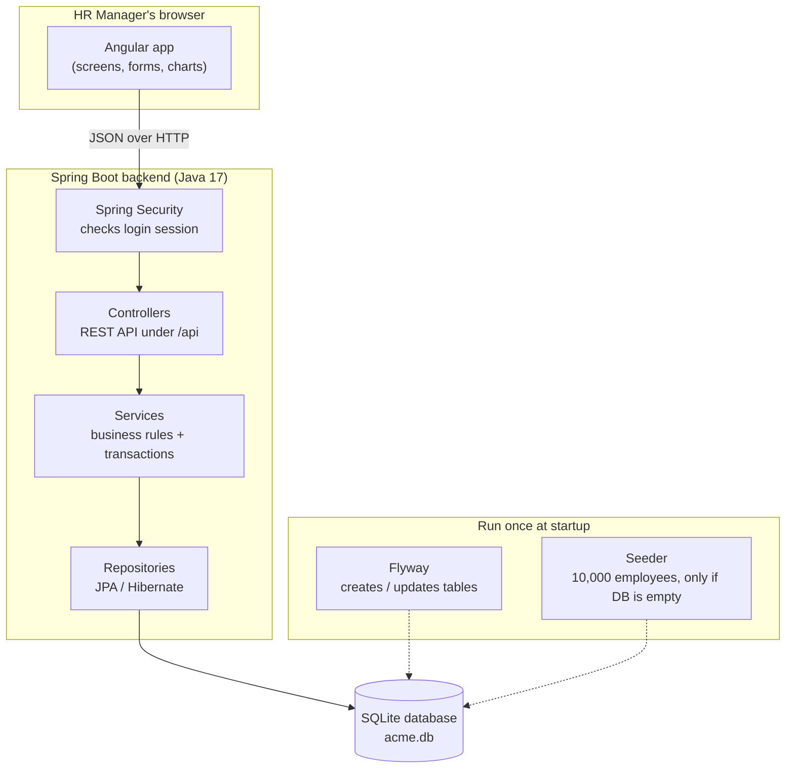
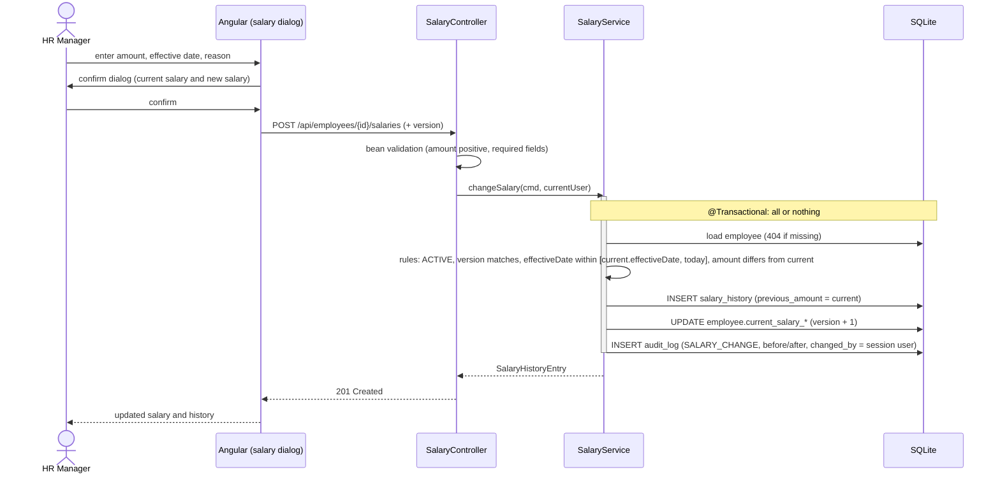
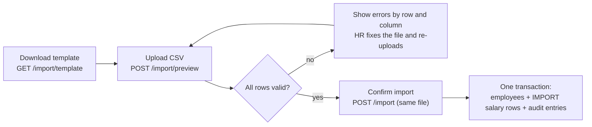

# Architecture: ACME Salary Management

Related docs: [`requirements.md`](./requirements.md) · [`database-schema.md`](./database-schema.md) · [`api-contracts.md`](./api-contracts.md) · [`ui-design.md`](./ui-design.md)

## 1. System overview

The system has three parts: the **Angular app** running in the HR manager's browser, a **Spring Boot backend**, and a **SQLite database** file.



**How to read it:**
- **Solid arrows** are the path every user action takes. The Angular app sends a JSON request, Spring Security checks the session, and then the request goes through controller → service → repository → database.
- **Dotted arrows** are startup tasks that run once when the application starts. They are not part of handling requests.
- **Where the Angular app comes from:** Spring Boot also serves the compiled Angular files (HTML, JS, CSS). The browser downloads them once and then talks only to `/api`.

**Why does Spring Boot serve the UI?** The API and the UI then come from the same origin. That means:
- no CORS configuration;
- the session cookie can be `HttpOnly` and `SameSite=Strict`;
- the build produces a single artifact (one jar).

During development, Angular's dev server (`ng serve`) forwards `/api` calls to Spring Boot, so the same-origin setup also holds locally. The cost is that the frontend and backend cannot be scaled separately. At 10,000 employees and one HR team, that will never be needed.

## 2. Repository layout

```
acme-salary-management/
├── backend/                 Spring Boot (Maven)
│   └── src/main/java/com/acme/salary/
│       ├── auth/            login/logout/me, SecurityConfig, AppUser, bootstrap admin from env vars
│       ├── employee/        Employee entity, repository, service, controller, DTOs, search Specification
│       ├── salary/          SalaryHistory entity, salary-change rules, controller
│       ├── audit/           AuditLog entity, AuditService (append-only), controller
│       ├── analytics/       aggregation queries + PayStatistics (min/max/avg/median/percentiles)
│       ├── reference/       Country, Department, JobTitle, FxRate lookups + /api/reference
│       ├── bulkimport/      CSV parsing (Apache Commons CSV), row validation, preview + import
│       ├── seed/            deterministic 10k-employee generator (JDBC batch insert)
│       └── common/          error handling (ProblemDetail), Clock bean, paging DTOs
│   └── src/main/resources/db/migration/   Flyway SQL migrations (V1__schema.sql, …)
├── frontend/                Angular (standalone components, signals) + Angular Material
│   └── src/app/
│       ├── core/            AuthService, auth guard, HTTP error interceptor, ReferenceDataService
│       ├── features/
│       │   ├── login/
│       │   ├── dashboard/        overview + country/department charts
│       │   ├── employees/        directory (table, filters, search), create/edit form, CSV import page
│       │   ├── employee-detail/  profile, salary history, audit tab, salary-change dialog
│       │   └── insights/         pay bands, recent changes
│       └── shared/          money pipe (currency-aware), confirm dialog, page layout
├── docs/
└── README.md
```

**Backend code is grouped by feature** (`employee/`, `salary/`, …) rather than by layer (`controllers/`, `services/`, …). Everything about one domain concept sits together, which makes each feature easier to read and test.

## 3. Backend layering

| Layer | Responsibility | Rule |
|---|---|---|
| **Controller** | HTTP mapping, request validation (`@Valid`), DTO ⇄ JSON | No business logic and no entities in responses |
| **Service** | Business rules and transactions (`@Transactional`) | The only layer that writes; it calls `AuditService` in the same transaction |
| **Repository** | Spring Data JPA, plus `Specification` for dynamic filters | No business rules |
| **Domain/DTO** | JPA entities (internal); Java `record` DTOs (API) | Entities never leave the service layer |

**Cross-cutting concerns:**
- **Errors:** one `@RestControllerAdvice` maps exceptions to RFC 7807 `ProblemDetail` responses (see `api-contracts.md` §2).
- **Time:** an injected `java.time.Clock` is used everywhere instead of `LocalDate.now()`, so date rules ("effective date not in the future") can be tested deterministically.
- **Optimistic locking:** `employee.version` (JPA `@Version`) blocks lost updates when two tabs edit the same employee.

## 4. Key flow: changing a salary



Every salary change asks for confirmation in the UI, whatever its size. The server applies every business rule itself; the UI checks are only there for a better experience.

## 5. Authentication

- Spring Security uses **form-style JSON login**: `POST /api/auth/login` creates a server-side `HttpSession`, and the browser holds it in a `JSESSIONID` cookie that is `HttpOnly`, `Secure` and `SameSite=Strict`.
- **CSRF:** `CookieCsrfTokenRepository` sets an `XSRF-TOKEN` cookie. Angular's `HttpClient` sends it back as `X-XSRF-TOKEN` automatically.
- **Idle timeout:** 30 minutes. An unauthenticated `/api/**` call gets `401` JSON (never a redirect). The Angular interceptor sends the user to `/login`.
- **Passwords:** BCrypt hashes. On startup, if `app_user` is empty, one HR Manager is created from the `ADMIN_USERNAME` and `ADMIN_PASSWORD` environment variables. No credentials are committed to the repo.
- **Trade-off:** sessions are held in memory, so restarting the application signs users out. That is acceptable for a single instance. Spring Session (JDBC) would fix it if ever needed.

## 6. Analytics approach

| Statistic | Computed in | Why |
|---|---|---|
| Count, sum, min, max, average | SQL `GROUP BY` over active employees | Cheap, and uses indexes |
| Median, p25, p75 | Java `PayStatistics` over sorted salary amounts for each group | SQLite has no `MEDIAN`/`PERCENTILE`. At 10k rows the in-memory work is under 10 ms, and a pure function is easy to unit test |
| USD conversion | Java, using `BigDecimal` with the `fx_rate` table | Stays exact and avoids floating-point drift from SQLite `REAL` |

**Statistics are never mixed across currencies.** Any group that spans countries (org-wide figures, departments without a country filter, pay bands without a country filter) is converted to USD first. Groups within one country use local currency.

The analytics read from `employee.current_salary_amount`, which is denormalised (see `database-schema.md` §3). They therefore never need a "latest row in history" sub-query.

**Scaling path:** if the org grew to more than 1M employees, the median calculation would move to SQL on PostgreSQL (`percentile_cont`), and the dashboard could be cached or pre-computed nightly. Neither is needed at 10k.

## 7. Seeding

- A `seed` component inserts 10,000 employees, their salary histories (1–4 rows each) and lookup data using **JDBC batch inserts**, which takes a few seconds; JPA would save rows one by one.
- **Deterministic:** it uses `new Random(42)` and a fixed reference date (no `now()`), so every run produces identical data, and tests and demos can rely on known values.
- **Idempotent:** it runs on startup only when `app.seed.enabled=true` and the `employee` table is empty.
- **Realistic pay:** base salary per country × department multiplier × level multiplier, ±15% jitter, rounded to the nearest 100 local currency units.

## 8. CSV import



- **Stateless:** preview stores nothing. The confirm step re-uploads the same file and validates it again before saving, so there are no temporary files to manage, and nothing can change between preview and import.
- **One set of rules:** each row is mapped to the same `CreateEmployeeCommand` as "Add employee" and checked by the same `EmployeeValidator`. Import only adds file-level checks: required headers, duplicate emails within the file, matching the currency column, and size limits.
- **Parsing:** Apache Commons CSV (RFC 4180, so quoted fields and commas inside names work). A UTF-8 byte-order mark is stripped. Department and job title names are matched case-insensitively against the lookup tables.
- **Performance:** 10,000 rows are validated in memory, using lookups loaded once and a single query for existing emails, then written with JDBC batch inserts. This should take a few seconds, so the request can be synchronous with no job queue.
- **Error report:** every invalid row is counted, but at most 500 error details are returned, so a completely wrong file doesn't produce a huge response.
- **Same structure as the seed:** the seeder can write `samples/employees-sample.csv` in the import format. That gives the demo a ready-made file and gives the tests a realistic input.

## 9. Testing strategy

| Level | Tools | What it covers |
|---|---|---|
| Unit (backend) | JUnit 5, AssertJ, Mockito | Salary-change rules, `PayStatistics` (median of even/odd/single/empty), FX conversion, seed determinism, audit diffing, CSV row validation (bad dates, unknown country, wrong currency, duplicate emails, BOM, quoted commas) |
| Slice/integration (backend) | `@DataJpaTest`, `@WebMvcTest`, `@SpringBootTest` + MockMvc on a temp SQLite file | Filters and paging, transaction rollback, error responses (400/401/404/409/422), security rules |
| Frontend | Angular TestBed with Jest or Karma | Directory filter ⇄ URL sync, salary dialog always asks for confirmation, auth guard |

Tests use a fixed `Clock` and fixed seeds and never call the network, so they are fast and deterministic.

## 10. Architecture decisions (summary)

| Decision | Chosen | Alternatives considered | Reason |
|---|---|---|---|
| Database | SQLite (single file) | PostgreSQL | The brief suggests it, one HR user means a single writer is fine, and there is no DB server to run. JPA + Flyway keeps a move to PostgreSQL to a config change plus SQL tweaks. |
| Schema management | Flyway SQL migrations, Hibernate `ddl-auto=validate` | `ddl-auto=update` | The schema is explicit and versioned, and we can add triggers and indexes that Hibernate can't generate. |
| Serving the UI | Spring Boot serves the Angular build (same origin) | Separate frontend server + API | No CORS, safer cookies, one build artifact |
| Auth | Server session + CSRF | JWT in localStorage | Same origin, revocable, and no tokens exposed to XSS |
| Current salary | Denormalised on `employee`, updated in the same transaction | "Latest history row" sub-query | Fast directory sort and filter by salary, and simpler analytics SQL |
| Median/percentiles | Java over sorted group values | SQL window functions | Simpler, unit-testable, and fast enough at 10k |
| Money storage | `INTEGER` whole currency units | `REAL` / decimal-as-text | SQLite has no DECIMAL type. Annual salaries are agreed in whole units, and integers avoid rounding errors. |
| CSV import | Preview then all-or-nothing import, stateless | Partial import (skip bad rows); server-side staging table | A migration must be complete and correct, and re-uploading is cheap at 10k rows |
| UI library | Angular Material | PrimeNG | Official Angular library, and its table, paginator and sort support server-side data |
