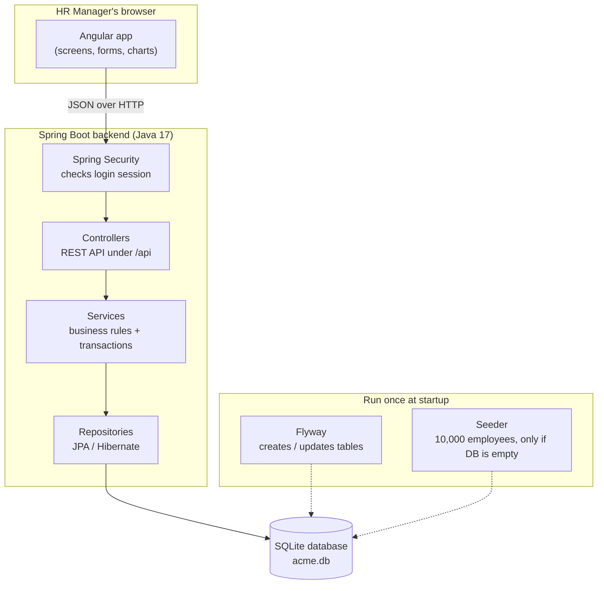
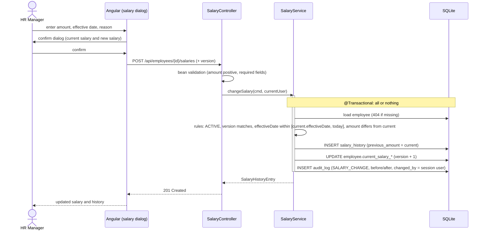
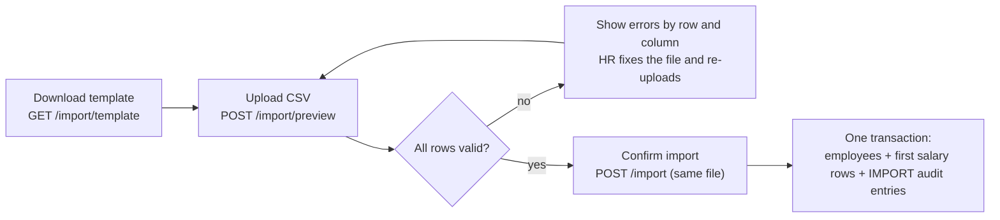

# Architecture: ACME Salary Management

Related docs: [`requirements.md`](./requirements.md) · [`database-schema.md`](./database-schema.md) · [`api-contracts.md`](./api-contracts.md) · [`ui-design.md`](./ui-design.md)

## 1. System overview

The system has three parts: the **Angular app** running in the HR manager's browser, a **Spring Boot backend**, and a **SQLite database** file.



**How to read it:**
- **Solid arrows** are the path every user action takes. The Angular app sends a JSON request, Spring Security checks the session, and then the request goes through controller → service → repository → database.
- **Dotted arrows** are startup tasks that run once when the application starts. They are not part of handling requests.
- **Where the Angular app comes from:** Spring Boot also serves the compiled Angular files (HTML, JS, CSS). The browser downloads them once and then talks only to `/api`.

**Why does Spring Boot serve the UI?** The API and the UI then come from the same origin. That means:
- no CORS configuration;
- the session cookie can be `HttpOnly` and `SameSite=Strict`;
- the build produces a single artifact (one jar).

During development, Angular's dev server (`ng serve`) forwards `/api` calls to Spring Boot, so the same-origin setup also holds locally. The cost is that the frontend and backend cannot be scaled separately. At 10,000 employees and one HR team, that will never be needed.

## 2. Repository layout

```
acme-salary-management/
├── backend/                 Spring Boot (Maven)
│   └── src/main/java/com/acme/salary/
│       ├── auth/            login/logout/me, SecurityConfig, AppUser and roles, users API, first super admin
│       ├── employee/        Employee entity, repository, service, controller, DTOs, search Specification
│       ├── salary/          SalaryHistory entity, salary-change rules, controller
│       ├── audit/           AuditLog entity, AuditService (append-only), controller
│       ├── analytics/       salary projection query + PayStatistics (min/max/avg/median/percentiles)
│       ├── reference/       Country, Department, JobTitle, FxRate lookups + /api/reference
│       ├── bulkimport/      CSV parsing (Apache Commons CSV), row validation, preview + import
│       ├── seed/            deterministic 10k-employee generator (JDBC batch insert)
│       └── common/          error handling (ProblemDetail), Clock bean, paging DTOs
│   └── src/main/resources/db/migration/   Flyway SQL migrations (V1__schema.sql, …)
├── frontend/                Angular 21 (standalone components, signals) + PrimeNG 21
│   └── src/app/
│       ├── core/            AuthService, auth guard, HTTP error interceptor, ReferenceDataService
│       ├── features/
│       │   ├── login/
│       │   ├── dashboard/        overview + country/department charts
│       │   ├── employees/        directory (table, filters, search), create/edit form, CSV import page
│       │   ├── employee-detail/  profile, salary history, audit tab, salary-change dialog
│       │   └── insights/         pay bands, recent changes
│       └── shared/          money pipe (currency-aware), confirm dialog, page layout
├── docs/
└── README.md
```

**Backend code is grouped by feature** (`employee/`, `salary/`, …) rather than by layer (`controllers/`, `services/`, …). Everything about one domain concept sits together, which makes each feature easier to read and test.

## 3. Backend layering

| Layer | Responsibility | Rule |
|---|---|---|
| **Controller** | HTTP mapping, request validation (`@Valid`), DTO ⇄ JSON | No business logic and no entities in responses |
| **Service** | Business rules and transactions (`@Transactional`) | The only layer that writes; it calls `AuditService` in the same transaction |
| **Repository** | Spring Data JPA, plus `Specification` for dynamic filters | No business rules |
| **Domain/DTO** | JPA entities (internal); Java `record` DTOs (API) | Entities never leave the service layer |

**Cross-cutting concerns:**
- **Errors:** one `@RestControllerAdvice` maps exceptions to RFC 7807 `ProblemDetail` responses (see `api-contracts.md` §2).
- **Time:** an injected `java.time.Clock` is used everywhere instead of `LocalDate.now()`, so date rules ("effective date not in the future") can be tested deterministically.
- **Optimistic locking:** `employee.version` (JPA `@Version`) blocks lost updates when two tabs edit the same employee.
- **Audit in the same transaction:** `AuditService.record` uses `Propagation.MANDATORY`, so it fails if called outside a transaction. An audit entry is always committed or rolled back together with the change it describes.
- **SQLite write locking:** transactions start in `IMMEDIATE` mode, so writers queue for SQLite's single write lock instead of racing for it. In the default mode, two concurrent writes could both read first, and the second one would then fail with `SQLITE_BUSY` instead of waiting. Concurrent changes to the *same* employee still return `409` through optimistic locking.

## 4. Key flow: changing a salary



Every salary change asks for confirmation in the UI, whatever its size. The server applies every business rule itself; the UI checks are only there for a better experience.

## 5. Authentication and roles

- Spring Security with a **JSON login endpoint**: `POST /api/auth/login` checks the password and saves the signed-in user in a server-side `HttpSession`. The browser holds it in a `JSESSIONID` cookie that is `HttpOnly` and `SameSite=Lax`, and `Secure` when `APP_COOKIE_SECURE=true` (set it behind HTTPS). Signing in issues a new session id and a new CSRF token.
- **CSRF:** a readable `XSRF-TOKEN` cookie (`csrf().spa()`). Angular's `HttpClient` sends it back as `X-XSRF-TOKEN` on every change. Sign-out clears it, so the app fetches a fresh one before each sign-in.
- **Idle timeout:** 30 minutes. An unauthenticated `/api/**` call gets `401` JSON (never a redirect), and a forbidden one `403`. The Angular interceptor sends the user to `/login`.
- **Two roles:** `SUPER_ADMIN` can do everything `HR_MANAGER` can, and is the only role allowed under `/api/users`, where it adds, disables, enables and resets HR managers. Super admin accounts can't be changed through the API.
- **Disabled users** are signed out on their next request: a small filter checks on every request that the signed-in user still exists and is enabled. That is one indexed lookup, which is negligible here.
- **Passwords:** BCrypt hashes, 10–72 characters (BCrypt reads only the first 72 bytes). On start-up, if there is no super admin, one is created from `APP_ADMIN_USERNAME` (default `admin`) and `APP_ADMIN_PASSWORD`. Without a password, a random one is generated and written to the log once. No credentials are committed to the repo.
- **Attribution:** `CurrentUser` reads the username from the session, so `changed_by` and audit entries can't be forged from a request body. Work outside a request is attributed to `system`.
- **Trade-off:** sessions are held in memory, so restarting the application signs users out. That is acceptable for a single instance. Spring Session (JDBC) would fix it if ever needed.

## 6. Analytics approach

| Statistic | Computed in | Why |
|---|---|---|
| Every statistic: count, total, min, max, average, median, p25, p75 | Java `PayStatistics` over the sorted salary amounts of each group | SQLite has no `MEDIAN`/`PERCENTILE`, and the median needs every value in the group anyway. One query loads a small projection of all active employees (country, department, title, level, amount: 10k rows), then Java groups it. One code path computes every figure, and a pure function is easy to unit test |
| Percentile method | Linear interpolation between ranks, rounded half-up to whole units | The same method as Excel's `PERCENTILE.INC`, which is what HR will check the numbers against |
| Recent changes (count and average % per reason) | SQL `GROUP BY reason`, plus a paged query | Only rows in the date window are read, and the list is paged |
| USD conversion | Java, using `BigDecimal` with the `fx_rate` table | Stays exact and avoids floating-point drift from SQLite `REAL` |

**Statistics are never mixed across currencies.** Any group that spans countries (org-wide figures, departments without a country filter, pay bands without a country filter) is converted to USD first. Groups within one country use local currency.

The analytics read from `employee.current_salary_amount`, which is denormalised (see `database-schema.md` §3). They therefore never need a "latest row in history" sub-query.

**Scaling path:** if the org grew to more than 1M employees, the median calculation would move to SQL on PostgreSQL (`percentile_cont`), and the dashboard could be cached or pre-computed nightly. Neither is needed at 10k.

## 7. Seeding

- The `seed` package inserts 10,000 employees with their salary histories (1–4 rows each) and audit entries using **JDBC batch inserts** in one transaction. It takes about a second; JPA would save rows one by one. The lookups come from the V2 migration.
- **Deterministic:** `new Random(42)` and a fixed reference date (`app.seed.reference-date`, no `now()`), so every run produces identical data, and tests and demos can rely on known values. If the reference date is ever later than today, today is used instead, so nothing is dated in the future.
- **Idempotent:** it runs at start-up when `app.seed.enabled=true` (the default; turn it off with `APP_SEED_ENABLED=false`) and only if the `employee` table is empty. To start over, delete the SQLite file and restart.
- **Realistic people:** weighted shares per country (US 30%, India 20%, UK 12%, …) and department (Engineering 30%, …), names suited to the country, managers and leads never below L3, hire dates up to eight years back, and about 5% leavers.
- **Realistic pay:** base salary per country × department × job title × level, ±15% jitter, rounded to the nearest 100 local currency units. Later changes are annual reviews (+2–6%), promotions (+8–15%), market adjustments (+3–8%) and corrections (±3%), at least six months apart; the starting salary is worked back from today's, so current pay always fits the role.
- **Same rows as the app writes:** the denormalised current salary, and audit entries in the app's own format (a `CREATE` per employee, a `SALARY_CHANGE` per later salary, a `DEACTIVATE` per leaver), all by `system-seed`.
- **Sample CSV:** with `APP_SEED_SAMPLE_CSV=samples/employees-sample.csv` it also writes 200 rows in the import format (§8). The rows are extra people, not copies of seeded ones, so the file imports cleanly into a seeded database.

## 8. CSV import



- **Stateless:** preview stores nothing. The confirm step re-uploads the same file and validates it again before saving, so there are no temporary files to manage, and nothing can change between preview and import.
- **One set of rules:** each row is mapped to the same `CreateEmployeeCommand` as "Add employee" and checked by the same `EmployeeValidator`. Import only adds file-level checks: required headers, duplicate emails within the file, matching the currency column, and size limits.
- **Parsing:** Apache Commons CSV (RFC 4180, so quoted fields and commas inside names work). A UTF-8 byte-order mark is stripped. Department and job title names are matched case-insensitively against the lookup tables.
- **Performance:** 10,000 rows are validated in memory, using lookups loaded once and a single query for existing emails, then written with JDBC batch inserts. This should take a few seconds, so the request can be synchronous with no job queue.
- **Error report:** every invalid row is counted, but at most 500 error details are returned, so a completely wrong file doesn't produce a huge response.
- **Reason vs. source:** a salary reason says *why* the pay is what it is, so there is no `IMPORT` reason. The imported row gets `NEW_HIRE`, the optional `salary_reason` from the file, or no reason ("not recorded"). *How* the employee got into the system is recorded by the `IMPORT` audit entry.
- **Same structure as the seed:** the seeder can write `samples/employees-sample.csv` in the import format. That gives the demo a ready-made file and gives the tests a realistic input.

## 9. Testing strategy

| Level | Tools | What it covers |
|---|---|---|
| Unit (backend) | JUnit 5, AssertJ, Mockito | Salary-change rules, `PayStatistics` (median of even/odd/single/empty), FX conversion, seed determinism, audit diffing, CSV row validation (bad dates, unknown country, wrong currency, duplicate emails, BOM, quoted commas) |
| Slice/integration (backend) | `@DataJpaTest`, `@WebMvcTest`, `@SpringBootTest` + MockMvc on a temp SQLite file | Filters and paging, transaction rollback, error responses (400/401/404/409/422), security rules |
| Frontend | Angular TestBed with Vitest and jsdom (the Angular 21 default), with the API faked by `HttpTestingController` | Add employee (validation, the request sent, server errors under fields), CSV import (file checks, preview report, import, a 422 after the check), pay insights (which columns sort, server-side sorting of recent changes, range bars), user management (actions, confirm before disabling, duplicate usernames) and the route guards |

Tests use a fixed `Clock` and fixed seeds and never call the network, so they are fast and deterministic.

## 10. Architecture decisions (summary)

| Decision | Chosen | Alternatives considered | Reason |
|---|---|---|---|
| Database | SQLite (single file) | PostgreSQL | The brief suggests it, one HR user means a single writer is fine, and there is no DB server to run. JPA + Flyway keeps a move to PostgreSQL to a config change plus SQL tweaks. |
| Schema management | Flyway SQL migrations, Hibernate `ddl-auto=validate` | `ddl-auto=update` | The schema is explicit and versioned, and we can add triggers and indexes that Hibernate can't generate. |
| Serving the UI | Spring Boot serves the Angular build (same origin) | Separate frontend server + API | No CORS, safer cookies, one build artifact |
| Hosting | Render free web service: one Docker image, Blueprint in `render.yaml` | Koyeb free instance; Oracle Cloud Always Free VM; Fly.io / Railway | Free, HTTPS, deploys on every push, no server to manage. Its disk is wiped on restart, which suits a demo: the seed rebuilds the same data on every start. Oracle would keep data but needs a VM, firewall and HTTPS set up by hand; Fly.io and Railway no longer have a free tier for new accounts |
| Start-up on a small instance | Class data sharing (a training run during the image build), C1 compiler only, serial GC | Lazy bean initialisation; GraalVM native image | On 0.1 CPU and 512 MB, start-up fell from about 136 s to 87 s with no code changes. Lazy initialisation moves errors to the first request; a native image needs reflection hints for JPA and Spring Security, which is a lot of work for a demo |
| Auth | Server session + CSRF | JWT in localStorage | Same origin, revocable, and no tokens exposed to XSS |
| Current salary | Denormalised on `employee`, updated in the same transaction | "Latest history row" sub-query | Fast directory sort and filter by salary, and simpler analytics SQL |
| SQLite transaction mode | `IMMEDIATE` (write lock at BEGIN) | Default `DEFERRED`; retrying on `SQLITE_BUSY` | Concurrent writers queue instead of failing. Transactions run one at a time, which is negligible for one HR team with millisecond queries |
| Salary rules | Plain `SalaryChangePolicy` class plus a bean-validation constraint | Rules inside the service | Rules can be unit-tested without Spring or a database, and request-shape errors come back as field errors |
| Sorting the directory by USD salary | `ORDER BY amount × CASE currency WHEN … THEN rate END` in the query | A stored `current_salary_usd` column | Rates change only with a deployment and there are 7 currencies, so a CASE expression stays small. No extra column to keep in sync and no migration |
| Pay statistics | All computed in Java from one projection query | SQL `GROUP BY` for count/sum/min/max plus Java for the median | One code path for every figure, unit-testable, and fast enough at 10k. A larger org would move to PostgreSQL `percentile_cont` (see section 6) |
| Money storage | `INTEGER` whole currency units | `REAL` / decimal-as-text | SQLite has no DECIMAL type. Annual salaries are agreed in whole units, and integers avoid rounding errors. |
| CSV import | Preview then all-or-nothing import, stateless | Partial import (skip bad rows); server-side staging table | A migration must be complete and correct, and re-uploading is cheap at 10k rows |
| UI library | PrimeNG 21 (Aura theme, MIT) | Angular Material (used until the redesign); PrimeNG 22 | Started on Material, which looked too plain. PrimeNG's design tokens give a more polished look and its lazy table supports server-side data. Pinned to 21 because 22 needs Angular 22 and is no longer MIT (it needs a PrimeUI licence key) |
| Angular version | 21 (LTS) | 22 (latest) | Chosen when the machine had Node 24.6 (Angular 22 needs 24.15+). Node is now pinned to 24.22.3 (`.nvmrc`), so moving to 22 is possible. 21 is still supported long-term, so the upgrade is not needed for this project |
| Frontend state | Signals in components, filter state in the URL, plain `HttpClient` services | NgRx store | Each screen owns its data and nothing is shared between screens except cached reference data. A store would add ceremony without solving a problem |
