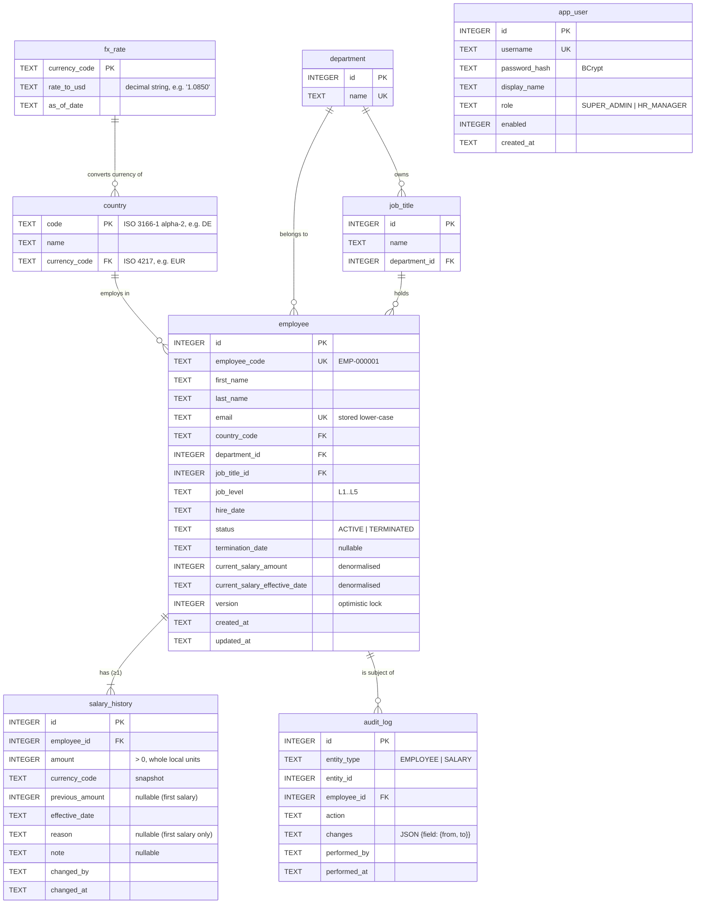

# Database Schema: ACME Salary Management

Database: **SQLite**, managed with **Flyway** migrations (`backend/src/main/resources/db/migration`). Hibernate runs with `ddl-auto=validate`, so the SQL migrations are the source of truth for the schema.

## 1. Entity-relationship diagram



## 2. Tables

### Reference data (seeded by migration, read-only through the API)
| Table | Purpose | Seed values |
|---|---|---|
| `fx_rate` | Static, versioned rates for converting to USD (one row per currency) | USD, GBP, EUR, INR, CAD, SGD, AUD |
| `country` | Countries ACME employs in. Each country fixes the salary currency | US, GB, DE, FR, IN, CA, SG, AU. DE and FR both use EUR, which tests the "same currency, different country" case |
| `department` | Controlled list, so there are no "Engg" vs "Engineering" variants | Engineering, Product, Design, Sales, Marketing, Customer Support, Finance, Human Resources, Operations, Legal |
| `job_title` | Role families, each belonging to one department | e.g. Engineering → Software Engineer, QA Engineer, DevOps Engineer, Engineering Manager |

**Job level** is a fixed enum stored as text, not a table: `L1` Associate · `L2` Mid · `L3` Senior · `L4` Lead · `L5` Principal. Keeping level separate from title means "Senior Software Engineer" is `Software Engineer` + `L3`, so pay bands can be grouped by title, by level, or both.

### `employee`
| Column | Type | Constraints / notes |
|---|---|---|
| `id` | INTEGER | PK, autoincrement |
| `employee_code` | TEXT | NOT NULL, UNIQUE. Generated `EMP-` + 6 digits inside the create transaction |
| `first_name`, `last_name` | TEXT | NOT NULL, 1–100 characters |
| `email` | TEXT | NOT NULL, UNIQUE, normalised to lower case |
| `country_code` | TEXT | NOT NULL, FK → `country`. **Cannot be changed after creation** (relocations are out of scope, because they would change the salary currency) |
| `department_id` | INTEGER | NOT NULL, FK → `department` |
| `job_title_id` | INTEGER | NOT NULL, FK → `job_title`. The service also checks that the title belongs to the selected department |
| `job_level` | TEXT | NOT NULL, CHECK IN (`L1`…`L5`) |
| `hire_date` | TEXT (ISO date) | NOT NULL, not in the future |
| `status` | TEXT | NOT NULL, CHECK IN (`ACTIVE`,`TERMINATED`), default `ACTIVE` |
| `termination_date` | TEXT | NULL unless TERMINATED. CHECK (`status`='TERMINATED') = (`termination_date` IS NOT NULL) |
| `current_salary_amount` | INTEGER | NOT NULL, CHECK > 0. Copy of the latest `salary_history.amount` |
| `current_salary_effective_date` | TEXT | NOT NULL. Copy of the latest `salary_history.effective_date` |
| `version` | INTEGER | NOT NULL, default 0. JPA `@Version` |
| `created_at`, `updated_at` | TEXT (ISO-8601 UTC) | NOT NULL |

### `salary_history` (append-only)
| Column | Type | Constraints / notes |
|---|---|---|
| `id` | INTEGER | PK |
| `employee_id` | INTEGER | NOT NULL, FK → `employee` |
| `amount` | INTEGER | NOT NULL, CHECK > 0. Annual gross base pay, in whole local currency units |
| `currency_code` | TEXT | NOT NULL. A snapshot, so history stays correct even if reference data changes |
| `previous_amount` | INTEGER | NULL for the first salary. Stored so that "% change" and "recent raises" need no self-join |
| `effective_date` | TEXT | NOT NULL. Between the previous salary's effective date and today, inclusive |
| `reason` | TEXT | CHECK IN (`NEW_HIRE`,`PROMOTION`,`ANNUAL_REVIEW`,`MARKET_ADJUSTMENT`,`CORRECTION`,`OTHER`). `NEW_HIRE` is set by the system only. NULL means "not recorded" and is allowed only on an employee's first salary (`CHECK (reason IS NOT NULL OR previous_amount IS NULL)`): an imported salary whose reason HR didn't know. How a row got into the system is not a reason; the audit log records that (`CREATE` vs `IMPORT`) |
| `note` | TEXT | NULL, ≤ 500 characters. Required when the reason is `OTHER` |
| `changed_by` | TEXT | NOT NULL. Username taken from the authenticated session |
| `changed_at` | TEXT | NOT NULL. Server timestamp |

The current salary is the latest row ordered by `(effective_date DESC, id DESC)`. That ordering decides ties when two changes share a date.

### `audit_log` (append-only)
| Column | Type | Constraints / notes |
|---|---|---|
| `id` | INTEGER | PK |
| `entity_type` | TEXT | CHECK IN (`EMPLOYEE`,`SALARY`) |
| `entity_id` | INTEGER | ID of the employee or salary_history row |
| `employee_id` | INTEGER | FK → `employee`. Always set, so an employee's full trail is one indexed query |
| `action` | TEXT | CHECK IN (`CREATE`,`IMPORT`,`UPDATE`,`DEACTIVATE`,`SALARY_CHANGE`) |
| `changes` | TEXT (JSON) | Only the fields that changed, with lookups by name: `{"department":{"from":"Sales","to":"Marketing"}}`. A value with no previous state has only `to` |
| `performed_by` | TEXT | NOT NULL. Session username, or `system-seed` for seeded rows |
| `performed_at` | TEXT | NOT NULL |

### `app_user`
| Column | Type | Constraints / notes |
|---|---|---|
| `id` | INTEGER | PK |
| `username` | TEXT | NOT NULL, UNIQUE. Case-sensitive: stored as entered, and sign-in must match the case. A unique index on `username COLLATE NOCASE` (migration V4) stops two usernames that differ only in case |
| `password_hash` | TEXT | NOT NULL, BCrypt |
| `display_name` | TEXT | NOT NULL |
| `role` | TEXT | NOT NULL, CHECK IN (`SUPER_ADMIN`, `HR_MANAGER`) (migration V3). A super admin can do everything an HR manager can and also manages users. The first super admin is created at start-up from environment variables |
| `enabled` | INTEGER | NOT NULL, default 1 |
| `created_at` | TEXT | NOT NULL |

## 3. Design notes

**Denormalised current salary.** Sorting the directory by salary and running analytics over 10,000 employees would otherwise need a "latest history row per employee" sub-query on every request. Instead, `SalaryService` updates `employee.current_salary_*` **in the same transaction** that inserts the history row, so the two cannot drift apart. An integration test checks they match after every change.

**History and audit cannot be changed.** On top of the service layer never issuing `UPDATE` or `DELETE` on them, the database enforces it with triggers:
```sql
CREATE TRIGGER salary_history_no_update BEFORE UPDATE ON salary_history
BEGIN SELECT RAISE(ABORT, 'salary_history is append-only'); END;
CREATE TRIGGER salary_history_no_delete BEFORE DELETE ON salary_history
BEGIN SELECT RAISE(ABORT, 'salary_history is append-only'); END;
-- same pair for audit_log
```

**No future-dated salary changes in v1.** Because effective dates can't be in the future, the latest row is always the salary in force today, and the denormalised copy stays correct without a scheduled job. Scheduled raises are a documented follow-up.

**SQLite specifics.**
- `PRAGMA foreign_keys = ON` is set on every connection; SQLite leaves it off by default.
- WAL journal mode lets the dashboard keep reading while a write is in progress.
- Dates are stored as ISO-8601 `TEXT`, so they sort correctly as strings.
- The `hibernate-community-dialects` `SQLiteDialect` is used.

## 4. Indexes

| Index | Supports |
|---|---|
| `employee(status, country_code, department_id)` | Directory filters (status is almost always included) and the analytics `GROUP BY` |
| `employee(job_title_id, job_level)` | Job-title filter and pay bands |
| `employee(last_name, first_name)` | Default sort by name |
| `employee(current_salary_amount)` | Sort by salary |
| `employee(hire_date)` | Sort by hire date |
| `salary_history(employee_id, effective_date DESC, id DESC)` | An employee's history, newest first |
| `salary_history(effective_date)` | Recent changes (last N days) |
| `audit_log(employee_id, performed_at DESC)` | The employee's audit tab |
| UNIQUE `employee(email)`, `employee(employee_code)`, `app_user(username)` | Uniqueness, and lookup by code |

**Free-text search** (`q` on name, code or email) uses `LIKE '%term%'`, which cannot use an index. At 10,000 rows a full scan takes a few milliseconds, which is well within the 300 ms target. If the org grew much larger, SQLite's FTS5 full-text index would be the next step.

## 5. Approximate data volume after seeding
| Table | Rows |
|---|---|
| `employee` | 10,000 |
| `salary_history` | 21,507 (1–4 per employee) |
| `audit_log` | 22,004 (a create row per employee, one per later salary row, one per leaver) |
| Reference tables | < 100 |

Measured on the default seed (`Random(42)`): the database file is about 13 MB, and seeding takes about a second.
