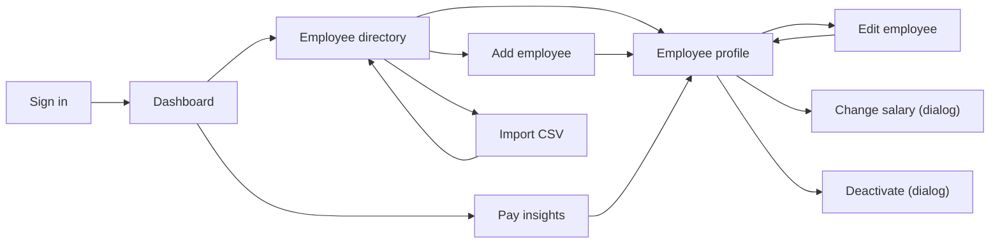

# UI Design: ACME Salary Management

Related docs: [`userstory.md`](./userstory.md) · [`api-contracts.md`](./api-contracts.md) · [`architecture.md`](./architecture.md)

**Stack:** Angular (standalone components, signals) with **Angular Material**, and charts with ng2-charts (Chart.js).
**Target:** desktop first (the HR manager works at a laptop). The layout stays usable on tablets.

---

## 1. Screens and routes

| Route | Screen | User stories | Main API calls |
|---|---|---|---|
| `/login` | Sign in | US-18 | `POST /auth/login` |
| `/dashboard` | Org overview (default after login) | US-11, US-15 | `GET /analytics/overview`, `GET /analytics/recent-changes?days=30` |
| `/employees` | Employee directory | US-01, 02, 03, 16 | `GET /employees`, `GET /employees/export` |
| `/employees/new` | Add employee | US-05 | `POST /employees` |
| `/employees/import` | Import from CSV | US-21 | `GET /import/template`, `POST /import/preview`, `POST /import` |
| `/employees/:id` | Employee profile (tabs: Details · Salary history · Audit log) | US-04, 09, 10 | `GET /employees/{id}`, `/salaries`, `/audit` |
| `/employees/:id/edit` | Edit employee | US-06 | `PUT /employees/{id}` |
| *(dialog on profile)* | Change salary | US-08 | `POST /employees/{id}/salaries` |
| *(dialog on profile)* | Deactivate employee | US-07 | `POST /employees/{id}/deactivate` |
| `/insights` | Pay insights (tabs: By country · By department · Pay bands · Recent changes) | US-12, 13, 14, 15 | `GET /analytics/*` |

Every route except `/login` is protected by an **auth guard**. Unknown routes redirect to `/dashboard`.

## 2. Navigation



- The **side navigation** is always visible: Dashboard · Employees · Pay insights.
- The **top bar** shows the app name, the signed-in user's name and a **Sign out** button.
- **Linking into profiles:** employee names in *Recent changes* (on the dashboard and insights pages) link to that employee's profile.

## 3. App shell (every page after sign-in)

```
┌──────────────────────────────────────────────────────────────────────────┐
│ ACME Salary Management                           Priya Sharma  [Sign out]│
├───────────────┬──────────────────────────────────────────────────────────┤
│ ▸ Dashboard   │                                                          │
│ ▸ Employees   │                   <page content>                         │
│ ▸ Pay insights│                                                          │
│               │                                                          │
└───────────────┴──────────────────────────────────────────────────────────┘
```
Material components: `mat-toolbar`, `mat-sidenav` (collapses to a menu icon on narrow screens), `mat-progress-bar` under the toolbar while requests are loading.

---

## 4. Screens

### 4.1 Sign in (`/login`)
```
              ┌──────────────────────────────┐
              │   ACME Salary Management     │
              │                              │
              │  Username [______________]   │
              │  Password [______________]   │
              │                              │
              │  ⚠ Invalid credentials       │  ← only after a failed attempt
              │                              │
              │           [ Sign in ]        │
              └──────────────────────────────┘
```
- If the user was sent here because their session expired, the page shows: *"Your session expired. Please sign in again."*
- After sign-in, the user goes back to the page they were on (`?returnUrl=`) or to `/dashboard`.

### 4.2 Dashboard (`/dashboard`)
```
┌ Dashboard ───────────────────────────────────────────────────────────────┐
│ ┌────────────┐ ┌────────────────┐ ┌───────────────┐ ┌───────────────┐    │
│ │ Headcount  │ │ Total payroll  │ │ Average salary│ │ Median salary │    │
│ │   9,512    │ │ $812.3M (USD)  │ │  $85,403      │ │  $72,100      │    │
│ └────────────┘ └────────────────┘ └───────────────┘ └───────────────┘    │
│                                                                          │
│ ┌ Headcount by country ──────────┐ ┌ Headcount by department ─────────┐  │
│ │ US ████████████ 3,010          │ │ Engineering ███████████ 3,120    │  │
│ │ IN █████████ 2,400             │ │ Sales       ██████ 1,610         │  │
│ │ DE █████ 1,243   ...           │ │ ...                              │  │
│ └────────────────────────────────┘ └──────────────────────────────────┘  │
│                                                                          │
│ ┌ Last 30 days ────────────────────────────────────────────────────────┐ │
│ │ 412 salary changes · average +6.4%            [View recent changes →]│ │
│ └──────────────────────────────────────────────────────────────────────┘ │
│ ⓘ USD figures use fixed exchange rates as of 2026-01-01  (view rates)    │
└──────────────────────────────────────────────────────────────────────────┘
```
- **KPI cards:** `mat-card`. **Charts:** horizontal bar charts, so long country and department names stay readable.
- **Clicking a bar** opens the directory already filtered to that country or department (`/employees?country=DE`).
- **"View rates"** opens a small dialog listing each currency's rate to USD.

### 4.3 Employee directory (`/employees`)
```
┌ Employees ─────────────────────────── [Import CSV] [Export CSV] [+ Add] ─┐
│ 🔍 Search name, code or email [_______________________]                  │
│ Country [DE, FR ▾]  Department [All ▾]  Job title [All ▾]                │
│ Level [All ▾]  Status [Active ▾]                                         │
│ Active filters: (Germany ✕) (France ✕)                     [Clear all]   │
├──────────────────────────────────────────────────────────────────────────┤
│ Code ▲      Name ↕          Job title         Department   Country Salary ↕  Status │
│ EMP-000042  Lena Fischer    Software Eng. L3  Engineering  DE   €78,000  Active    │
│ EMP-000107  Hugo Martin     Sales Rep. L2     Sales        FR   €51,000  Active    │
│ ...                                                                      │
├──────────────────────────────────────────────────────────────────────────┤
│ 1,243 employees            Rows: [25 ▾]      ‹ 1 2 3 … 50 ›              │
└──────────────────────────────────────────────────────────────────────────┘
```
- **Server-side everything:** `mat-table` + `mat-sort` + `mat-paginator` call `GET /employees`. Only the current page is ever loaded.
- **Search:** the request is sent 300 ms after the user stops typing (debounced).
- **Filters:**
  - The country, department, job title and level selects allow several values each (`mat-select multiple`).
  - The job title options are limited to the departments already chosen.
- **The URL holds every setting:** `/employees?q=lena&country=DE&country=FR&page=2&sort=salary,desc`. Refresh, back and forward keep the same view, and the link can be shared.
- **Changing any filter** resets the table to page 1.
- **Clicking a row** opens the profile.
- **Salary column:** shown in local currency with its symbol. If the results contain more than one currency and the table is sorted by salary, a hint appears: *"Salaries are in local currency. Filter to one country to compare."*
- **Empty result:** *"No employees match these filters"* with a **Clear filters** button.

### 4.4 Employee profile (`/employees/:id`)
```
┌──────────────────────────────────────────────────────────────────────────┐
│ ← Employees                                                              │
│ Lena Fischer   EMP-000042   (Active)        [Edit] [Change salary] [Deactivate] │
│ Software Engineer · L3 Senior · Engineering · Germany                   │
│                                                                          │
│ ┌ Current salary ──────────────────────┐                                 │
│ │ €78,000 / year   (≈ $84,630)         │                                 │
│ │ Effective since 1 Apr 2026           │                                 │
│ └──────────────────────────────────────┘                                 │
│                                                                          │
│ [ Details ] [ Salary history ] [ Audit log ]                             │
│ ──────────────────────────────────────────────────────────────────────── │
│ (tab content)                                                            │
└──────────────────────────────────────────────────────────────────────────┘
```
- **Details tab:** email, country and currency, department, job title, level, hire date, and termination date if any.
- **Salary history tab:** a table, newest first, with columns Effective date · Amount · % change · Reason · Note · Changed by · Changed at. A missing reason (possible only on an imported first salary) shows as *Not recorded*. A small line chart above it shows salary over time.
- **Audit log tab:** a paged list of entries such as *"1 Nov 2026 08:30, hr.manager: Job title Software Engineer → Engineering Manager, Level L3 → L4"*.
- **Terminated employees:** the status chip says *Terminated*. The Edit, Change salary and Deactivate buttons are hidden, and a banner explains that the record is read-only.

### 4.5 Change salary (dialog, two steps)
**Step 1: Enter the change**
```
┌ Change salary: Lena Fischer ───────────────────────┐
│ Current salary   €78,000  (since 1 Apr 2026)       │
│                                                    │
│ New annual salary  [ 84,000      ] EUR             │  ← currency fixed by country
│ Effective date     [ 01/11/2026 📅 ]               │  ← min = 1 Apr 2026, max = today
│ Reason             [ Promotion          ▾ ]        │
│ Note               [ Promoted to Lead        ]     │  ← required if reason = Other
│                                                    │
│                           [Cancel]  [Review →]     │
└────────────────────────────────────────────────────┘
```
**Step 2: Confirm (always shown, for every change)**
```
┌ Confirm salary change ─────────────────────────────┐
│ Employee        Lena Fischer (EMP-000042)          │
│ Current salary  €78,000                            │
│ New salary      €84,000                            │
│ Effective       1 Nov 2026                         │
│ Reason          Promotion: "Promoted to Lead"      │
│                                                    │
│                           [← Back]  [Confirm]      │
└────────────────────────────────────────────────────┘
```
- **Field checks:** **Review** stays disabled until the form is valid. Invalid fields show inline messages (amount > 0, amount different from current, date range, note required for Other).
- **After confirming:** the dialog closes, a toast says *"Salary updated"*, and the profile, current salary card and history reload.
- **Errors from the server:** a `422` (for example, someone else already changed the effective date) is shown inside the dialog. A `409 STALE_VERSION` is handled as described in §5.

### 4.6 Deactivate employee (dialog)
```
┌ Deactivate Lena Fischer? ──────────────────────────┐
│ The employee will be marked as Terminated and      │
│ excluded from analytics. Their records are kept.   │
│                                                    │
│ Termination date  [ 31/10/2026 📅 ]                │
│                                                    │
│                       [Cancel]  [Deactivate]       │  ← red (warn) button
└────────────────────────────────────────────────────┘
```

### 4.7 Add / Edit employee (`/employees/new`, `/employees/:id/edit`)
```
┌ Add employee ────────────────────────────────────────────────────────────┐
│ Personal                                                                 │
│   First name [__________]   Last name [__________]                       │
│   Email      [______________________]                                    │
│ Job                                                                      │
│   Country    [Germany ▾]     (currency: EUR)                             │
│   Department [Engineering ▾] Job title [Software Engineer ▾]             │
│   Level      [L3 Senior ▾]   Hire date [15/03/2021 📅]                   │
│ Starting salary                    ← create only                         │
│   Annual salary [ 72,000 ] EUR                                           │
│                                                    [Cancel]  [Save]      │
└──────────────────────────────────────────────────────────────────────────┘
```
- **Same form for create and edit.**
  - On **edit**, the Country field is disabled, with the hint *"Country can't be changed"*, and the Starting salary section is hidden (salary changes only through the dialog).
- **Job title:** the options reload when the department changes, and a selected title that doesn't belong to the new department is cleared.
- **Currency:** shown next to the salary field, based on the chosen country. It can't be typed.
- **Server errors:**
  - `409 DUPLICATE_EMAIL` → an error under the Email field.
  - `400` field errors → shown under the matching fields.
- **Unsaved changes:** leaving the form with unsaved changes asks *"Discard changes?"* (a `canDeactivate` guard).
- **After saving:** the user goes to the profile, with a toast *"Employee created"* or *"Employee updated"*.

### 4.8 Import from CSV (`/employees/import`): three-step `mat-stepper`
```
┌ Import employees ────────────────────────────────────────────────────────┐
│ (1) Upload ──── (2) Review ──── (3) Done                                 │
│                                                                          │
│ STEP 1  Download the template, fill it from your spreadsheet, save as CSV│
│         [⬇ Download template]                                            │
│         [ Choose file… ]  acme-germany.csv (412 KB)        [Check file →]│
│                                                                          │
│ STEP 2  1,250 rows · ✅ 1,247 valid · ❌ 3 with errors                   │
│         ┌ Errors ───────────────────────────────────────────────┐        │
│         │ Row  Column        Value                Problem        │        │
│         │ 214  country_code  DX                   unknown country│        │
│         │ 560  email         a.roy@acme.example   duplicate of row 12 │   │
│         │ 902  currency      USD                  must be EUR for DE  │   │
│         └───────────────────────────────────────────────────────┘        │
│         Preview of first 5 rows (to check the columns were read right)   │
│         Fix the rows in your file and upload it again.                   │
│                          [← Choose another file]  [Import 1,250 rows]    │  ← disabled while errors > 0
│                                                                          │
│ STEP 3  ✅ 1,250 employees imported.      [Go to employees]              │
└──────────────────────────────────────────────────────────────────────────┘
```
- **Preview first:** "Check file" calls `/import/preview` and saves nothing.
- **Import:** the import button sends the **same file** to `/import`. It's enabled only when there are no errors.
- **Large error lists:** if more than 500 errors are found, the page says *"Showing the first 500 of N errors"*.
- **Bad files:** `INVALID_FILE` and `FILE_TOO_LARGE` show as a message in step 1.

### 4.9 Pay insights (`/insights`): four tabs
**By country:** one row per country.
```
Country   Currency  Headcount  Min      Median   Max       Average   Median (USD)
Germany   EUR       1,243      €41,000  €66,500  €162,000  €69,871   $72,153
India     INR       2,400      ₹6.2L    ₹18.5L   ₹95.0L    ₹22.1L    $22,200
...
```

**By department:** a country selector, defaulting to *All countries (USD)*, above the same kind of table with one row per department.
- With **All countries**, every figure is in USD.
- With **one country chosen**, figures are in that country's currency.
- A caption always says which currency is shown.

**Pay bands:**
- **Filters:** job title, level and country (all optional).
- **Rows:** one per title × level, with columns min · p25 · median · p75 · max, plus a **range bar**:
  ```
  Software Engineer L3   €68k ├────[ ▮ ]────┤ €96k   (median €78.5k, 96 people)
  ```
- **Small groups:** bands with fewer than 3 people show a *"Low sample"* chip.

**Recent changes:**
- **Period selector:** 30, 90, 180 or 365 days.
- **Summary cards:** number of changes and average % change.
- **By-reason table.**
- **Paged list of changes:** each row shows the employee (linked to their profile), old → new salary, %, reason and date.

---

## 5. Shared behaviour

| Situation | What the user sees |
|---|---|
| Loading | Progress bar under the toolbar. Tables keep the previous rows, slightly faded, so they don't jump around |
| `400` validation | Messages under the matching form fields |
| `401` (session expired) | An interceptor sends the user to `/login?returnUrl=…` with *"Your session expired"* |
| `404` | *"Employee not found"* page with a link back to the directory |
| `409 STALE_VERSION` | Dialog: *"This record was changed by someone else. Reload to see the latest version."* → **[Reload]** |
| `422` business rule | The server's `detail` message in a banner inside the form or dialog |
| `5xx` / network error | Toast: *"Something went wrong. Please try again."* The technical details go to the console only |
| Success | Toast (`mat-snack-bar`), e.g. *"Salary updated"* |

## 6. Formatting rules
- **Money:** a single `money` pipe uses `Intl.NumberFormat` with the currency code and no decimals: `€78,000`, `$84,630`, `₹18,00,000` (Indian grouping for INR). Short forms (`$812.3M`, `₹18.5L`) appear only on dashboard cards and charts.
- **Dates:** shown as `1 Nov 2026`, sent to the API as `2026-11-01`.
- **Status:** a chip with a text label (*Active* / *Terminated*), so the status never depends on colour alone.

## 7. Accessibility
- Every input has a visible label (Material form fields). Errors are linked to their field so screen readers announce them.
- Everything works by keyboard: tables, dialogs (focus stays in the dialog, and Esc closes it) and the stepper.
- Colour contrast meets WCAG AA in the Material theme.

## 8. Frontend structure (how screens map to code)
```
src/app/
├── core/        auth.service, auth.guard, http-error.interceptor, reference-data.service (caches GET /reference)
├── shared/      money.pipe, confirm-dialog, status-chip, page-header
└── features/
    ├── login/            login.page
    ├── dashboard/        dashboard.page, kpi-card, headcount-chart
    ├── employees/        directory.page, employee-form.page, import.page, employee-filters
    ├── employee-detail/  profile.page, salary-history-tab, audit-tab, change-salary.dialog, deactivate.dialog
    └── insights/         insights.page, by-country-tab, by-department-tab, pay-bands-tab, recent-changes-tab
```
Each feature has its own API service that wraps `HttpClient` and returns typed models that mirror `api-contracts.md`. Page state is kept in signals. The directory's filter state lives in the URL, read through `ActivatedRoute`.
