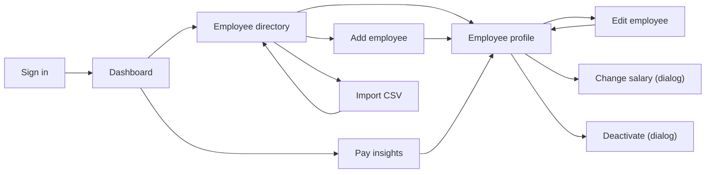

# UI Design: ACME Salary Management

Related docs: [`userstory.md`](./userstory.md) · [`api-contracts.md`](./api-contracts.md) · [`architecture.md`](./architecture.md)

**Stack:** Angular 21 (standalone components, signals) with **PrimeNG 21** (Aura theme), and charts with ng2-charts (Chart.js).

> **Built so far:** sign in, dashboard, directory, profile with tabs, add/edit form, change-salary and deactivate dialogs, pay insights, and user management for super admins. CSV import (§4.8) is designed here but not built yet. Export CSV (US-16, *Could*) is not built.
**Target:** desktop first (the HR manager works at a laptop). The layout stays usable on tablets.

---

## 1. Screens and routes

| Route | Screen | User stories | Main API calls |
|---|---|---|---|
| `/login` | Sign in | US-18 | `POST /auth/login` |
| `/dashboard` | Org overview (default after login) | US-11, US-15 | `GET /analytics/overview`, `GET /analytics/recent-changes?days=30` |
| `/employees` | Employee directory | US-01, 02, 03, 16 | `GET /employees`, `GET /employees/export` |
| `/employees/new` | Add employee | US-05 | `POST /employees` |
| `/employees/import` | Import from CSV | US-21 | `GET /import/template`, `POST /import/preview`, `POST /import` |
| `/employees/:id` | Employee profile (tabs: Details · Salary history · Audit log) | US-04, 09, 10 | `GET /employees/{id}`, `/salaries`, `/audit` |
| `/employees/:id/edit` | Edit employee | US-06 | `PUT /employees/{id}` |
| *(dialog on profile)* | Change salary | US-08 | `POST /employees/{id}/salaries` |
| *(dialog on profile)* | Deactivate employee | US-07 | `POST /employees/{id}/deactivate` |
| `/insights` | Pay insights (tabs: By country · By department · By job title · Recent changes) | US-12, 13, 14, 15 | `GET /analytics/*` |
| `/users` | Users (super admins only) | US-22 | `GET /users`, `POST /users`, `PATCH /users/{id}`, `PUT /users/{id}/password` |

Every route except `/login` is protected by an **auth guard**; `/users` also needs a super admin (anyone else lands on the dashboard). Unknown routes redirect to `/dashboard`.

## 2. Navigation



- The **side navigation** is always visible: Dashboard · Employees · Pay insights.
- The **top bar** shows the app name, the signed-in user's name and a **Sign out** button.
- **Linking into profiles:** employee names in *Recent changes* (on the dashboard and insights pages) link to that employee's profile.

## 3. App shell (every page after sign-in)

```
┌──────────────────────────────────────────────────────────────────────────┐
│ ▣ ACME        │                                                          │
│ Salary mgmt   │                                                          │
├───────────────┤                   <page content>                         │
│ ▸ Dashboard   │                                                          │
│ ▸ Employees   │                                                          │
│ ▸ Pay insights│                                                          │
│ ▸ Users       │  ← super admins only                                     │
│               │                                                          │
│ (PS) Priya S. │                                                          │
│ HR manager [⇥]│  ← signed-in user and Sign out                           │
└───────────────┴──────────────────────────────────────────────────────────┘
```
A fixed side navigation with the app name, and the signed-in user's name, role and a Sign out button at the bottom. Below 900px it becomes a drawer (`p-drawer`) opened from a top bar. A thin `p-progressbar` runs along the top of the page while requests are loading. The app's one toast (`p-toast`) and confirm dialog (`p-confirmdialog`) sit in the app root, so they work on the sign-in page too.

---

## 4. Screens

### 4.1 Sign in (`/login`)
```
              ┌──────────────────────────────┐
              │   ACME Salary Management     │
              │                              │
              │  Username [______________]   │
              │  Password [______________]   │
              │                              │
              │  ⚠ Invalid credentials       │  ← only after a failed attempt
              │                              │
              │           [ Sign in ]        │
              └──────────────────────────────┘
```
- If the user was sent here because their session expired, the page shows: *"Your session expired. Please sign in again."*
- After sign-in, the user goes back to the page they were on (`?returnUrl=`, only paths inside the app) or to `/dashboard`.
- A disabled account gets the same *"Invalid credentials"* message, so the page never reveals which accounts exist.

### 4.10 Users (`/users`, super admins only)
- **Table:** name and username, role (Super admin / HR manager), status (Active / Disabled), date added, and actions.
- **Add HR user** (page action): a dialog with Username, Name and Temporary password (at least 10 characters, shared privately). A taken username shows under the field.
- **Row actions for HR managers:** *Reset password* (a dialog with the new password) and *Disable* / *Enable*. Disabling asks first, because it signs the person out straight away.
- **Super admin rows** show *"Can't be changed here"* instead of actions.

### 4.2 Dashboard (`/dashboard`)
```
┌ Dashboard ───────────────────────────────────────────────────────────────┐
│ ┌────────────┐ ┌────────────────┐ ┌───────────────┐ ┌───────────────┐    │
│ │ Headcount  │ │ Total payroll  │ │ Average salary│ │ Median salary │    │
│ │   9,512    │ │ $812.3M (USD)  │ │  $85,403      │ │  $72,100      │    │
│ └────────────┘ └────────────────┘ └───────────────┘ └───────────────┘    │
│                                                                          │
│ ┌ Headcount by country ──────────┐ ┌ Headcount by department ─────────┐  │
│ │ US ████████████ 3,010          │ │ Engineering ███████████ 3,120    │  │
│ │ IN █████████ 2,400             │ │ Sales       ██████ 1,610         │  │
│ │ DE █████ 1,243   ...           │ │ ...                              │  │
│ └────────────────────────────────┘ └──────────────────────────────────┘  │
│                                                                          │
│ ┌ Last 30 days ────────────────────────────────────────────────────────┐ │
│ │ 412 salary changes · average +6.4%            [View recent changes →]│ │
│ └──────────────────────────────────────────────────────────────────────┘ │
│ ⓘ USD figures use fixed exchange rates as of 2026-01-01  (view rates)    │
└──────────────────────────────────────────────────────────────────────────┘
```
- **KPI cards:** `p-card` tiles with a label, the figure, one line of context and an icon. **Charts:** horizontal bar charts, so long country and department names stay readable.
- **Clicking a bar** opens the directory already filtered to that country or department (`/employees?country=DE`).
- **"View rates"** opens a small dialog listing each currency's rate to USD.

### 4.3 Employee directory (`/employees`)
```
┌ Employees ─────────────────────────── [Import CSV] [Export CSV] [+ Add] ─┐
│ 🔍 Search name, code or email [_______________________]                  │
│ Country [DE, FR ▾]  Department [All ▾]  Job title [All ▾]                │
│ Level [All ▾]  Status [Active ▾]                                         │
│ Active filters: (Germany ✕) (France ✕)                     [Clear all]   │
├──────────────────────────────────────────────────────────────────────────┤
│ Code ▲      Name ↕          Job title         Department   Country Salary ↕  Status │
│ EMP-000042  Lena Fischer    Software Eng. L3  Engineering  DE   €78,000  Active    │
│ EMP-000107  Hugo Martin     Sales Rep. L2     Sales        FR   €51,000  Active    │
│ ...                                                                      │
├──────────────────────────────────────────────────────────────────────────┤
│ 1,243 employees            Rows: [20 ▾]      ‹ 1 2 3 … 63 ›              │
└──────────────────────────────────────────────────────────────────────────┘
```
- **Server-side everything:** a lazy `p-table` (sorting and paging) calls `GET /employees`. Only the current page is ever loaded.
- **Search:** the request is sent 300 ms after the user stops typing (debounced).
- **Filters:**
  - The country, department, job title and level selects allow several values each (`p-multiselect`).
  - The job title options are limited to the departments already chosen.
- **The URL holds every setting:** `/employees?q=lena&country=DE&country=FR&page=2&sort=salary,desc`. Refresh, back and forward keep the same view, and the link can be shared.
- **Changing any filter** resets the table to page 1.
- **Clicking a row** opens the profile.
- **Salary column, with a "Salary in: Local currency | USD" switch** at the right edge above the table (kept in the URL as `?salaryIn=usd`):
  - **Local currency** (default): each salary with its own currency symbol. If the results mix currencies and the table is sorted by salary, a hint suggests switching to USD to sort fairly.
  - **USD:** the header becomes "Salary (USD)". Converted amounts show as *≈ $101,790*, with the local amount on hover; USD-paid employees show their salary as is. Sorting by salary uses the USD amount (`sort=salaryUsd`), so countries compare fairly. Switching goes back to page 1.
  - **USD is disabled** when the country filter covers only USD-paid countries (today: the United States), because the figures would be identical. The hover text explains why.
- **Empty result:** *"No employees match these filters"* with a **Clear filters** button.

### 4.4 Employee profile (`/employees/:id`)
```
┌──────────────────────────────────────────────────────────────────────────┐
│ ← Employees                                                              │
│ Lena Fischer   EMP-000042   (Active)        [Edit] [Change salary] [Deactivate] │
│ Software Engineer · L3 Senior · Engineering · Germany                   │
│                                                                          │
│ ┌ Current salary ──────────────────────┐                                 │
│ │ €78,000 / year   (≈ $84,630)         │                                 │
│ │ Effective since 1 Apr 2026           │                                 │
│ └──────────────────────────────────────┘                                 │
│                                                                          │
│ [ Details ] [ Salary history ] [ Audit log ]                             │
│ ──────────────────────────────────────────────────────────────────────── │
│ (tab content)                                                            │
└──────────────────────────────────────────────────────────────────────────┘
```
- **Details tab:** email, country and currency, department, job title, level, hire date, and termination date if any.
- **Salary history tab:** a table, newest first, with columns Effective date · Amount · % change · Reason · Note · Changed by · Changed at. A missing reason (possible only on an imported first salary) shows as *Not recorded*. A step chart above it shows salary over time on a real date axis, with the current salary drawn up to today. It appears only when the salaries span more than one date; several changes on the same day show as one vertical step.
- **Audit log tab:** a paged list of entries such as *"1 Nov 2026 08:30, hr.manager: Job title Software Engineer → Engineering Manager, Level L3 → L4"*.
- **Terminated employees:** the status chip says *Terminated*. The Edit, Change salary and Deactivate buttons are hidden, and a banner explains that the record is read-only.

### 4.5 Change salary (dialog, two steps)
**Step 1: Enter the change**
```
┌ Change salary: Lena Fischer ───────────────────────┐
│ Current salary   €78,000  (since 1 Apr 2026)       │
│                                                    │
│ New annual salary  [ 84,000      ] EUR             │  ← currency fixed by country
│ Effective date     [ 01/11/2026 📅 ]               │  ← min = 1 Apr 2026, max = today
│ Reason             [ Promotion          ▾ ]        │
│ Note               [ Promoted to Lead        ]     │  ← required if reason = Other
│                                                    │
│                           [Cancel]  [Review →]     │
└────────────────────────────────────────────────────┘
```
**Step 2: Confirm (always shown, for every change)**
```
┌ Confirm salary change ─────────────────────────────┐
│ Employee        Lena Fischer (EMP-000042)          │
│ Current salary  €78,000                            │
│ New salary      €84,000                            │
│ Effective       1 Nov 2026                         │
│ Reason          Promotion: "Promoted to Lead"      │
│                                                    │
│                           [← Back]  [Confirm]      │
└────────────────────────────────────────────────────┘
```
- **Field checks:** **Review** stays disabled until the form is valid. Invalid fields show inline messages (amount > 0, amount different from current, date range, note required for Other).
- **After confirming:** the dialog closes, a toast says *"Salary updated"*, and the profile, current salary card and history reload.
- **Errors from the server:** a `422` (for example, someone else already changed the effective date) is shown inside the dialog. A `409 STALE_VERSION` is handled as described in §5.

### 4.6 Deactivate employee (dialog)
```
┌ Deactivate Lena Fischer? ──────────────────────────┐
│ The employee will be marked as Terminated and      │
│ excluded from analytics. Their records are kept.   │
│                                                    │
│ Termination date  [ 31/10/2026 📅 ]                │
│                                                    │
│                       [Cancel]  [Deactivate]       │  ← red (warn) button
└────────────────────────────────────────────────────┘
```

### 4.7 Add / Edit employee (`/employees/new`, `/employees/:id/edit`)
```
┌ Add employee ────────────────────────────────────────────────────────────┐
│ Personal                                                                 │
│   First name [__________]   Last name [__________]                       │
│   Email      [______________________]                                    │
│ Job                                                                      │
│   Country    [Germany ▾]     (currency: EUR)                             │
│   Department [Engineering ▾] Job title [Software Engineer ▾]             │
│   Level      [L3 Senior ▾]   Hire date [15/03/2021 📅]                   │
│ Starting salary                    ← create only                         │
│   Annual salary [ 72,000 ] EUR                                           │
│                                                    [Cancel]  [Save]      │
└──────────────────────────────────────────────────────────────────────────┘
```
- **Same form for create and edit.**
  - On **edit**, the Country field is disabled, with the hint *"Country can't be changed"*, and the Starting salary section is hidden (salary changes only through the dialog).
- **Job title:** the options reload when the department changes, and a selected title that doesn't belong to the new department is cleared.
- **Currency:** shown next to the salary field, based on the chosen country. It can't be typed.
- **Server errors:**
  - `409 DUPLICATE_EMAIL` → an error under the Email field.
  - `400` field errors → shown under the matching fields.
- **Unsaved changes:** leaving the form with unsaved changes asks *"Discard changes?"* (a `canDeactivate` guard).
- **After saving:** the user goes to the profile, with a toast *"Employee created"* or *"Employee updated"*.

### 4.8 Import from CSV (`/employees/import`): three-step `p-stepper`
```
┌ Import employees ────────────────────────────────────────────────────────┐
│ (1) Upload ──── (2) Review ──── (3) Done                                 │
│                                                                          │
│ STEP 1  Download the template, fill it from your spreadsheet, save as CSV│
│         [⬇ Download template]                                            │
│         [ Choose file… ]  acme-germany.csv (412 KB)        [Check file →]│
│                                                                          │
│ STEP 2  1,250 rows · ✅ 1,247 valid · ❌ 3 with errors                   │
│         ┌ Errors ───────────────────────────────────────────────┐        │
│         │ Row  Column        Value                Problem        │        │
│         │ 214  country_code  DX                   unknown country│        │
│         │ 560  email         a.roy@acme.example   duplicate of row 12 │   │
│         │ 902  currency      USD                  must be EUR for DE  │   │
│         └───────────────────────────────────────────────────────┘        │
│         Preview of first 5 rows (to check the columns were read right)   │
│         Fix the rows in your file and upload it again.                   │
│                          [← Choose another file]  [Import 1,250 rows]    │  ← disabled while errors > 0
│                                                                          │
│ STEP 3  ✅ 1,250 employees imported.      [Go to employees]              │
└──────────────────────────────────────────────────────────────────────────┘
```
- **Preview first:** "Check file" calls `/import/preview` and saves nothing.
- **Import:** the import button sends the **same file** to `/import`. It's enabled only when there are no errors.
- **Large error lists:** if more than 500 errors are found, the page says *"Showing the first 500 of N errors"*.
- **Bad files:** `INVALID_FILE` and `FILE_TOO_LARGE` show as a message in step 1.

### 4.9 Pay insights (`/insights`): four tabs
**By country:** one row per country.
```
Country  Currency  People  Lowest   Typical range (middle half)  Typical (median)  Highest   Average   Typical (USD)
Germany   EUR       1,243      €41,000  €66,500  €162,000  €69,871   $72,153
India     INR       2,400      ₹6.2L    ₹18.5L   ₹95.0L    ₹22.1L    $22,200
...
```

**By department:** a country selector, defaulting to *All countries (USD)*, above the same kind of table with one row per department.
- With **All countries**, every figure is in USD.
- With **one country chosen**, figures are in that country's currency.
- A caption always says which currency is shown.

**By job title** (pay bands, US-14; `?tab=job-title`):
- **Filters:** department, job title, level and country (all optional). The job title list shows only titles in the chosen department; a chosen title that isn't in a newly chosen department is cleared.
- **Rows:** one per title × level, with columns People · Lowest · Typical range (middle half) · Typical (median) · Highest, in full amounts so offers can be checked against them (or a Range bar in the bar view).
- **Small groups:** bands with fewer than 3 people show a *"Low sample"* chip.

**Recent changes:**
- **Period selector:** 30, 90, 180 or 365 days.
- **Summary cards:** number of changes and average % change.
- **By-reason table.**
- **Paged list of changes:** each row shows the employee (linked to their profile), old → new salary, %, reason and date.

---

**Column names (all pay tables):** statistical terms are replaced by plain words, and hovering a column name shows its meaning (`shared/pay-columns.ts`).

Column order everywhere: People · Lowest · Typical range (middle half) · Typical (median) · Highest · Average.

**Sorting:** click a numeric column header to sort; the first click puts the highest first, and sorting goes back to page 1.
- **By department** and **By job title:** every numeric column sorts (the typical range by its lower figure, and the Range bar by the typical salary), because each view uses one currency.
- **By country:** only **People** and **Typical (USD)** sort. The other figures are each in their country's own currency, so ordering them across countries would rank rupees against dollars.
- **Recent changes:** **Change (%)** and **Effective** date sort, on the server, so the order covers every change in the period, not just the page shown. Old → new amounts don't sort, because they mix currencies.

| Shown as | Statistic | Hover text |
|---|---|---|
| People | headcount | Number of active employees in the group |
| Lowest | min | The lowest salary in the group |
| Typical range (middle half) | 25th – 75th percentile, shown as "€66,000 – €92,000" | What the middle half of people earn |
| Typical (median) | median, in bold | The middle salary: half of people earn less, half earn more |
| Highest | max | The highest salary in the group |
| Average | mean | Total pay divided by the number of people. Use it for budgets |
| Typical (USD) | median converted to USD (by country only) | So countries can be compared |
| Range | bar (`shared/range-bar.ts`) | Lowest to highest, split into four quarters of the people (lightest to darkest), with a dark mark at the median |

**Numbers / Range bars switch** (`shared/pay-view.ts`): above the right edge of each of the three pay tables, with the bar key to its left in the bar view. The choice is shared by all three tables and kept while the app is open.
- **Numbers** (default): People · Lowest · Typical range (middle half) · Typical (median) · Highest · Average (plus Currency and Typical (USD) by country).
- **Range bars:** the four range columns are replaced by one wide **Range** column. People, Average and Typical (USD) stay as numbers, because the bar doesn't show them.
- **Same row height in both views (66px)**, so the table doesn't jump when switching.

**Range bar** (`shared/range-bar.ts`, design 2 "Quartile segments" from the design canvas):
- **Shape:** runs from lowest to highest, split into four quarters of the people (lightest to darkest), with a dark mark at the median.
- **Scale:** each bar is scaled to its **own row**, so it shows how that group's pay is spread, not how rows compare.
- **Figures under the bar:** lowest, the typical salary (bold) and highest always; the 25th and 75th percentiles only when they wouldn't overlap another label. All five are in the hover text.
- **Everyone earns the same** (e.g. one person): a single shade, with the mark and one figure in the middle.
- **Key:** `shared/range-legend.ts`, shown in the bar view.

**Tables (all screens):**
- **At most 20 rows at a time.** The directory offers 10 or 20 per page (default 20), and recent changes shows 20. Both are paged by the server. Pay tables and salary history arrive in full and are paged in the browser (`shared/paging.ts`). The audit log shows 10 entries per page. **Every table always shows its page control**, even with one page, so the count is always visible (e.g. *1 – 8 of 8*).
- **Spacing:** cells have 14px top and bottom and 20px left and right padding, and tables sit 12px below their caption text.

## 5. Shared behaviour

| Situation | What the user sees |
|---|---|
| Loading | Thin progress bar at the top of the page. On first load the directory shows placeholder rows; later loads keep the current rows under the table's loading overlay, so nothing jumps around |
| `400` validation | Messages under the matching form fields |
| `401` (session expired) | An interceptor sends the user to `/login?returnUrl=…` with *"Your session expired"* |
| `404` | *"Employee not found"* page with a link back to the directory |
| `409 STALE_VERSION` | Dialog: *"This record was changed by someone else. Reload to see the latest version."* → **[Reload]** |
| `422` business rule | The server's `detail` message in a banner inside the form or dialog |
| `5xx` / network error | Toast: *"Something went wrong. Please try again."* The technical details go to the console only |
| Success | Toast (`p-toast`), e.g. *"Salary updated"*. Success toasts close after 3 s; error toasts stay until dismissed |

## 6. Formatting rules
- **Money:** a single `money` pipe uses `Intl.NumberFormat` with the currency code and no decimals: `€78,000`, `$84,630`, `₹18,00,000` (Indian grouping for INR). Short forms (`$812.3M`, `₹18.5L`) appear only on dashboard cards and charts.
- **Dates:** shown as `1 Nov 2026`, sent to the API as `2026-11-01`.
- **Status:** a chip with a text label (*Active* / *Terminated*), so the status never depends on colour alone.

## 7. Accessibility
- Every input has a visible label above it. Errors are linked to their field (`aria-describedby`) so screen readers announce them.
- Everything works by keyboard: tables, dialogs (focus stays in the dialog, and Esc closes it) and the stepper.
- Colour contrast meets WCAG AA: the theme (`app/theme.ts`) adjusts Aura's primary colour and input borders where its defaults fall short.

## 8. Frontend structure (how screens map to code)
```
frontend/src/app/
├── core/        models (types mirroring api-contracts.md), employees.api, analytics.api,
│                reference-data (loaded once at start-up), http.interceptors (progress bar, 5xx toast),
│                api-error (reads the RFC 7807 body), dates (ISO conversion, date-picker validator), notify (toasts)
├── layout/      shell (side navigation, drawer on narrow screens, progress bar, toast, confirm dialog)
├── shared/      money.pipe, labels, confirm-dialog (also the 409 "changed by someone else" dialog),
│                status-chip, unsaved-changes.guard, described-by, charts (Chart.js theme), paging
└── features/
    ├── dashboard/        dashboard.page, fx-rates.dialog
    ├── employees/        directory.page, directory-query (URL ⇄ filters), employee-form.page
    ├── employee-detail/  profile.page, salary-history-tab, audit-tab, change-salary.dialog, deactivate.dialog
    └── insights/         insights.page, by-country-tab, by-department-tab, pay-bands-tab, recent-changes-tab
```
- **Data loading:** API services wrap `HttpClient` and return typed models. Pages keep their state in signals. When a request depends on changing inputs (filters, page, period), the page turns those signals into an observable and uses `switchMap`, so an older response can never overwrite a newer one.
- **Directory state lives in the URL** and is read through `ActivatedRoute` (`directory-query.ts` converts both ways).
- **Errors:** an interceptor shows one toast for network and 5xx errors. Forms and dialogs show 4xx errors next to the fields or in a banner (§5).
- **Charts:** Chart.js is registered only on the pages that draw charts, so it is not in the first download.
